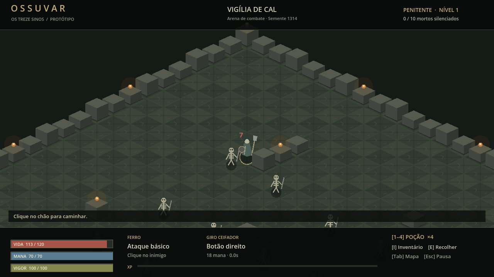

# OSSUVAR — Os Treze Sinos

> Um sino tocou onde não devia. Agora, ninguém parte.

Protótipo local de ARPG 2D isométrico em Godot **4.7.2 Standard**, Compatibility.
Esta branch acrescenta uma arena jogável ao bootstrap da T-001 (PR #2).
Não representa o Ato I completo nem conclui os marcos do Documento Mestre.

## Jogar

1. Faça checkout da branch `codex/prototipo-vigilia`.
2. Importe `project.godot` no Godot 4.7.2 e pressione **F5**.
3. Selecione **Entrar na Vigília**. Elimine os dez esqueletos para concluir a arena.

Não precisa de Node, Python, servidor ou conta para jogar no Editor.
Resolução mínima: 1280×720. Ainda não há executável Windows exportado.

| Controle | Ação |
| --- | --- |
| Clique esquerdo no chão | Caminhar pela grade, contornando obstáculos |
| Clique esquerdo no esqueleto | Aproximar e repetir ataque básico |
| Botão direito | Giro Ceifador com custo de mana e cooldown |
| 1–4 | Usar uma carga do mesmo estoque de poções de vida |
| E | Recolher drops próximos |
| I | Abrir/fechar inventário; pausa a simulação |
| F no inventário | Equipar Ferro funerário, +6 de dano básico |
| Tab | Alternar mapa esquemático completo da arena |
| Esc | Pausar/continuar |
| R | Reiniciar, inclusive após a morte |

## Nesta arena



- Piso isométrico 64×32 em TileMapLayer, obstáculos, câmera e AStarGrid2D.
- Simulação local em passos de 25 Hz, chance de acertar e intervalo entre ataques.
- Dez esqueletos com perseguição, aviso antes do ataque, dano e morte.
- Giro Ceifador; mana, poções, XP e níveis provisórios.
- Drops de um item demonstrativo, inventário de 12 posições e equipamento funcional.
- HUD horizontal; Vigor reservado, sem corrida nesta versão.
- Tela inicial com ilustração original gerada para OSSUVAR.

O mapa é fixo; a semente controla o sorteio dos ataques. O inventário usa itens
de uma célula, sem arrastar, afixos ou raridades. Níveis restauram vida; ainda não
há distribuição de atributos. Cenário e personagens de combate são provisórios.
Não há save, chefe, campanha, animações finais, áudio, multiplayer nem as doze
skills. O combate ainda não contém todo o pipeline do GDD.

## Arquitetura e validação

`ArenaRun` contém a simulação, `ArenaRules` os parâmetros em Resource,
`ArenaView` desenha o mundo, `ArenaHud` desenha a interface e `prototype.gd`
monta os objetos e encaminha entradas. `IsoMath` centraliza as conversões.
Veja [o recorte e suas limitações](docs/PROTOTIPO_VIGILIA.md).

GUT **9.6.1** permanece como no bootstrap, com licença MIT incluída.

```sh
godot --headless --path . --editor --import
godot --headless --path . -s addons/gut/gut_cmdln.gd -gdir=res://tests -gexit
python -m pip install gdtoolkit==4.3.4
gdlint core combat data ui world tests
```

[Referências visuais e procedência da imagem](docs/REFERENCIAS_VISUAIS.md).
A documentação narrativa do PR #1 continua independente desta branch.
PRs em draft, sem merge automático.
